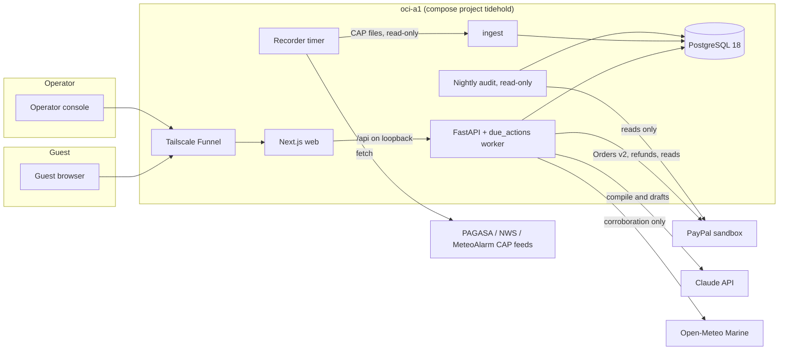

# Devpost submission draft

Draft for plan step 12 (README for judges, architecture diagram, impact text). Written 2026-10-25 from the code at `9213d25` and the plan's attachments; step 12 turns it into the README and the Devpost story after the demo seed (step 9, unit 8) and the model order (step 11) land. Places marked **[step 12]** need material that does not exist yet.

## Tagline

Weather-cancellation deposits for dive operators: the operator's own cancellation wording, compiled into cited rules, settled through PayPal when the operator cancels.

## The problem

Dive trips in Southeast Asia are cancelled by weather, and every operator words the consequence differently. Of 15 operators whose public terms we read (Indonesia, the Philippines, Thailand; `docs/plans/2026-10-19-tidehold-hackathon/research-operators.md`, read 2026-10-18), weather clauses range from a full refund through credit only and "at our discretion" to no refund:

- Pure Dive Resort, Nusa Penida, takes PayPal and ties its refund to an official warning: "unless there has been an official storm warning issued by the local authorities".
- Blue Ribbon Divers, Anilao: "No cash refund is issued for weather cancellations" (credit toward rebooking).
- Dragon Dive Komodo, when the national park closes for weather: "no refund will be possible as this is beyond our control".

Typhoons are frequent where these operators work: PAGASA counts about 20 tropical cyclones a year entering the Philippine Area of Responsibility, about 70% of them from July to October. During this build the recorder captured PAGASA Tropical Cyclone Warnings for Super Typhoon Rosal (2026-10-20 to 10-23), the warning the demo replays.

What is missing is not a payment button. It is applying the operator's own wording consistently, with the clause shown to the guest, and moving the money as that wording says without anyone retyping amounts.

Honest limits of the research: 5 of the 15 operators state on their own pages that they take PayPal, and the PayPal fee (3 to 4.5%) is usually passed to the guest; how often trips are actually cancelled for weather has no public statistics.

## What tidehold does

1. **Compile.** The operator pastes its cancellation section. Claude (`claude-sonnet-5-5`) compiles it into structured rules: the trigger (an operator cancellation, optionally conditioned on an official warning from a named national service), the remedy (refund, credit or none, with percent and any deduction), who chooses, and whether it applies to the deposit, the balance or both. Every rule carries a verbatim span of the wording, located in code; a paraphrase is refused. A clause that is silent or left to the operator's discretion becomes "needs operator ruling", never a guess. Without a model key the operator writes the same rules by hand.
2. **Book.** Guests pay the deposit at booking and the balance before the trip (30 days before by default) through PayPal Checkout; both are captured at once.
3. **Watch.** Official CAP warnings from PAGASA (Philippines), NWS (United States marine) and MeteoAlarm (Europe) are recorded and matched in code against the event set the operator confirmed. A matched warning alone never moves money; it asks the operator.
4. **Cancel and settle.** Only the operator's recorded cancellation (a trip day, or the rest of the trip, with its cause) starts a settlement. Code computes every amount from the compiled rules; inside the operator's mandate it refunds through PayPal or records credit, outside it, or on any unruled clause, it stops and asks.
5. **Explain.** Each guest's page shows the cancellation, the warnings in force and the clause behind the outcome.

## How we use PayPal

- Orders v2 with `intent: CAPTURE` for the deposit and the balance, through PayPal Checkout (the JS SDK buttons), with a server-side sandbox card as the fallback.
- Payments v2 refunds of a capture, several per payment, never above what it captured; each deduction comes only from the operator's own wording.
- Every write is stored before it is sent with a stable `PayPal-Request-Id`; an unknown outcome is resolved by reading the order, capture or refund before anything is resent.
- A nightly read-only reconciliation compares every money command with PayPal's order (captures, refunds and their statuses) and reports any mismatch; its client cannot send anything but reads.
- Sandbox only, pinned in code: the base URL is a constant and credentials load only with `PAYPAL_ENV=sandbox`.

## How we use AI, and where we do not

- The model compiles wording into rules, proposes event sets for warning conditions, and drafts operator asks and guest explanations (with a template fallback).
- The model never supplies an amount, never decides a cancellation and is never called during settlement.
- Measured before choosing (`model-benchmark.md`, 2026-10-23, 9 operators' real wording, a dev split for tuning and a held-out split never read while tuning): `claude-sonnet-5-5` produced valid structured output on 17 of 18 compiles, located 100% of its quoted spans, and matched every event set (16/16); its needs-ruling recall was 100% on dev and 65% on held-out, and rule-level recall 80% and 42%. Those held-out numbers are why every rule shows its quote and the operator confirms before publishing.

## Architecture

Backend layers, top to bottom (enforced by import-linter): bootstrap, settlement, holds, trips, policy, then warnings, money and identity, then platform. Scheduled work runs on a PostgreSQL `due_actions` table with leases, not a workflow engine.

## Try it

- Demo: https://tidehold.tail357fef.ts.net (PayPal sandbox; do not enter real personal data; rebuilt every night at 11:00 UTC).
- **[step 12]** The judge path: open the demo operator, see its compiled policy with quoted clauses, replay the recorded typhoon warning, cancel a trip day, watch the refunds and the guest page. Written once the demo seed exists.
- **[step 12]** Sandbox buyer account for the PayPal checkout, or the test-card path.
- **[step 12]** Video (under 3 minutes) and screenshots.

## Built with

Python 3.13, FastAPI, psycopg 3, PostgreSQL 18, Next.js 16, TypeScript, AG Grid, PayPal Orders v2 and Payments v2, the Anthropic Claude API, CAP 1.2, Open-Meteo Marine, Docker Compose, Tailscale Funnel, GitHub Actions.

## Quality and safety

- Every security control is listed with the test that proves it (`docs/threat-model.md`); cross-workspace IDs answer 404; per-workspace PayPal and per-address workspace-creation caps; a daily cap on live model calls.
- Random-order tests against real PostgreSQL, Playwright on desktop and mobile widths in CI, suppression and test-count locks, pinned actions and images, gitleaks, osv-scanner, zizmor.

## Real operators' wording

Clauses are quoted from public pages with source URL and access date (`bench/` fixtures, `research-operators.md`). The demo operator is fictional and carries no real operator's branding.
